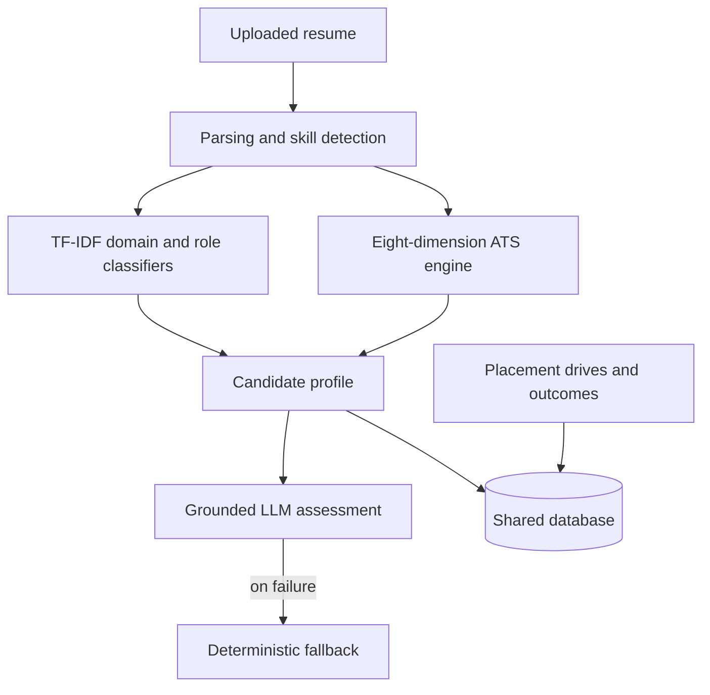

# JobMode: AI Placement Intelligence Platform

JobMode combines resume intelligence and campus placement management in one system, so resume analysis, candidate guidance and recruitment records share the same data.

Built by a 3-member team at the Centre for Artificial Intelligence, CHRIST University: **Deon Thomas Binny, Noel Lalichan and Sayanth I R**.

## The problem

Campus placement data sits in separate tools. Resumes, job descriptions, eligibility rules and interview outcomes rarely inform each other, and students usually learn a resume is weak only after a rejection.

## What it does

- **Resume analysis:** parses resumes, detects skills with section weighting, and normalizes them with a synonym dictionary and fuzzy matching.
- **Domain and role classification:** TF-IDF features with gradient-boosted trees.
- **ATS scoring:** a rule-based engine scores resumes on a 100-point scale across eight dimensions.
- **Skill-gap analysis:** compares detected skills against a role taxonomy.
- **Grounded LLM assessment:** the LLM receives a structured candidate profile, not raw resume text, and a deterministic fallback builds the same output if generation fails.
- **Placement management:** drives, eligibility checks, round tracking and outcome recording, with role-based access for students, teachers and placement staff.

## Architecture



## Evaluation

| Task | Data | Result |
|---|---|---|
| Domain classification | 135 curated examples | 48.1% accuracy, macro-F1 0.469 |
| Role classification | 265 curated examples | 50.9% accuracy, macro-F1 0.504 |
| Profile-strength regressor | 2,500 synthetic profiles | MAE 2.09, R² 0.832 |

## Limitations

- **This is not a placement predictor.** The regressor's target was computed from its own input features, so it approximates a scoring function. We report the output as a **Profile Strength Index**.
- No validation against real hiring outcomes has been done.
- The classification sets are small and were labelled by the team.
- Skill matching is lexical, so differently worded requirements may not match.

## Project structure

```text
backend/
  ai_model/          Parsing, classifiers, skill normalization
  api/               FastAPI routes
  database/          SQLAlchemy models and sessions
  placement/         Placement drive engine
  learning_layer/    Outcome dataset and retraining path
  knowledge_graph/   Skill relationships
  user_intelligence/ Candidate features
  services/          Business logic
frontend/            React portals
tests/               Automated tests
docs/                Documentation
```

## Getting started

Requires Python 3.11+ and Node.js 20+.

```bash
python -m venv venv
venv\Scripts\activate
pip install -r requirements.txt
```

On Windows, `start.bat` sets up and starts the backend and frontend. To start them yourself, see `backend/README.md` and `frontend/README.md`.

The database defaults to a local SQLite file at `backend/ai_placement.db`. Set `DATABASE_URL` to use another database, after installing its driver.

## Research

A paper on this work is awaiting publication.
